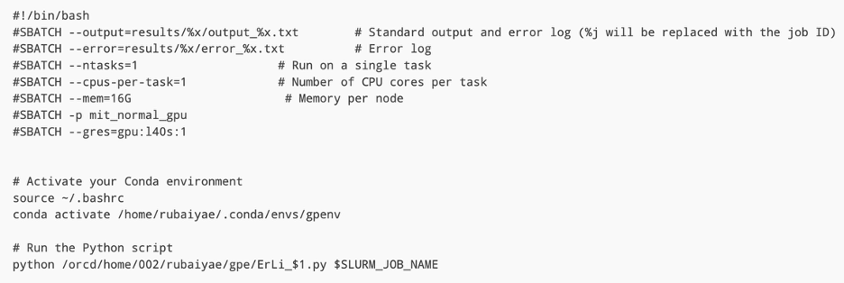
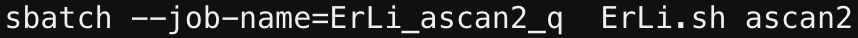
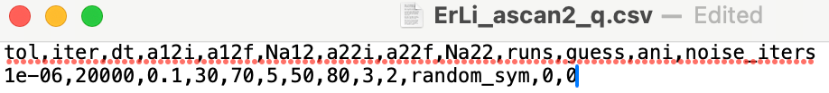
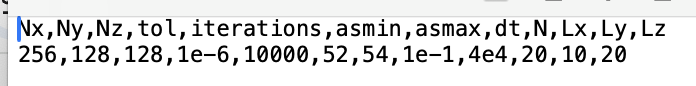

# General notes on solver

- The psis are normalized to 1, so actual densities should have an
  additional factor of N1, N2

- When there's a harmonic trap, typically the length unit used is the
  oscillator length in some direction; the time unit is the
  corresponding trap frequency. For the mixture in the 3D box,
  everything is done in units of a~11~.

- The functions which actually run a simulation (regardless of dimension
  or number of species) are called run_simulation_ite and
  run_simulation_rte. The first of these is for ground state finding and
  the second for real time evolution. I haven't done anything with real
  time evolution so use at your own risk.

- The simulations work by doing imaginary time evolution with a
  split-step solver. Imaginary time evolution means that, at every time
  step, we apply $e^{- Hdt}$, to find solutions of the GP equation,
  $\mu\psi = H\psi$. Split-step means we calculate the kinetic energy
  term in Fourier space and the potential energy in real space and apply
  them separately. At each timestep we apply first the kinetic
  propagator for ½ a timestep, then the potential for a full timestep,
  then kinetic again for ½ a timestep.

- For the single species code, the physical problem is defined by
  specification of the potential function, typically either
  harmonic+contact or harmonic+dipolar+contact.

- For the mixture code, the physical problem is defined by specification
  of the kinetic and potential propagators. To this end, there are
  several options given including terms like harmonic, dipolar, and LHY
  contributions for the potential. The kinetic propagator depends on
  whether or not there are hard boundaries in the system.

- The dipolar interaction is calculated from its Fourier transform. This
  inherently places periodic boundary conditions upon the simulation
  region which can result in spurious effects due to interactions
  between imaginary copies of the density profile. To avoid this, you
  can use propagators which employ a cutoff radius on the dipolar
  potential. See
  <https://journals.aps.org/pra/pdf/10.1103/PhysRevA.74.013623>.

- There are also functions defined to calculate the components of the
  energy (harmonic, contact, dipolar, kinetic, etc.). If the appropriate
  functions is passed as an argument to run_simulation_ite or
  run_simulation_rte, the energy component of largest magnitude is used
  to set the timestep. Otherwise the timestep is just in units of the
  characteristic timescale set, which is usually a trap frequency.

- For droplet states, multiple initial guesses are often needed to find
  the ground state. I found it most effective to use around 5 guesses of
  randomly sized Gaussians with some random noise.

# Running GPE simulations on the cluster

- Go to the Engaging cluster: engaging-ood.mit.edu

- Create a conda virtual environment and use conda to install cupy.

  - To do this, I used the Interactive Apps tab on Engaging OnDemand to
    request a Jupyter notebook with a GPU allocated. I then opened a
    terminal window and ran "conda create ---name gpenv"

    - gpenv was the name of my virtual environment

  - I then installed cupy using the following code:

    - conda activate gpenv

    - conda install cupy

  - I then tested that this worked by choosing gpenv as the environment
    for the Jupyter notebook and running some code using cupy.

    - Tester code:

> import cupy as cp
>
> print(cp.linspace(0,1,2))

- Now write an appropriate shell script for what you want to run. The
  main script I use is ErLi.sh:

- 

- The conda activate line is important because it activates the correct
  virtual environment with cupy installed. The code **will not run** if
  this line does not activate the correct virtual environment. In my
  case, the environment is called gpenv. To find the correct location,
  you can run "conda info \--envs" in terminal.

- To send a job using this script I go to a login node and use a snippet
  of code like this: 

- The job name is very important here. The python scripts try to read
  the simulation parameters from the file job-name.csv, and they save
  their outputs into the folder results/job-name/. The shell script
  saves the output and error logs into the same folder.

  - In this case, ErLi_ascan2_q.csv looks like this:
    
    The top row gives the names of the
    various parameters to be read, and the bottom row is the values. The
    values are read in within ErLi_ascan2.py.

- The last string tells it which python script to run. I have a few
  different python scripts, including ErLi_Nscan.py, ErLi_ascan.py,
  ErLi_ascan2.py. So, by specifying this final string, I can adjust
  which one of these scripts runs.

- The Engaging cluster has a time limit of 2 hours on any job. The
  scripts for scanning different parameters (like ErLi_Nscan.py) are
  written to check if they are about to hit a time limit and, if so,
  send a new job over an updated parameter range. It is still important
  to make sure that all of the runs for the same set of parameters will
  complete within the 2 hour time limit. (Note that this can be multiple
  simulations if the "runs" parameter is greater than 1, because in that
  case the code does multiple runs at each point in the parameter
  space). In practice this means you want to keep the maximum number of
  iterations and the number of runs sufficiently small.

- The simulation automatically saves several output parameters in a csv
  file. It can also save the final psi in a .npz file by setting
  saveData to True (it's False by default to avoid running out of memory
  as the data files are quite large). If you want to use the final psi
  from a previous simulation as the initial psi (i.e., to keep running
  after one simulation completes), you can specify "prev" as the guess.

**\**

# Description of files

## Scripts containing main functions

- analysis_fns.py

  - Contains plotting functions for single and dual species

  - Also contains functions to calculate contrast and the Leggett
    superfluid bound.

- gpe_functions_2D.py (in 2D_code folder)

  - Old code for running simulations with a single species in 2D. Not
    used frequently so might be buggy.

- gpe_functions_3D.py

  - Main file containing functions for running 3D single species
    simulations without a gpu.

- gpe_mixture.py

  - Main file containing functions for running 3D dual species
    simulations without a gpu

- gpe_mixture_fns_gpu.py

  - File containing all functions (running + analysis) for 3D dual
    species simulations on the GPU

- plot_fns_gpu.py

  - File containing plotting functions for 3D single species simulations
    on GPU

- gpe_fns_gpu.py

  - File containing functions for running 3D single species simulations
    on GPU

## Mathematica notebooks
- roton_dispersion_2D.nb: calculates dispersion of uniform 2D dipolar/nondipolar mixture
- roton_dispersion_1D.nb: calculates dispersion of uniform 1D dipolar/nondipolar mixture

## Self-contained Jupyter notebooks

- GPE_single_species_colab.ipynb

  - Very useful Jupyter notebook for finding ground states of dipolar
    BECs

  - I ran this in Google Colab with a GPU

  - Very nice for updating code to be GPU compatible and for active
    debugging of droplet state finding (since easy to update parameters
    and monitor simulation)

- dipolar_gpe_stabillity.ipynb

  - Old code for looking at collapse of dipolar condensates; never
    worked that well

## Single species simulations without GPU

### Erbium

- Er_only_droplets.py

  - Code finding Er droplet and supersolid states in the trap from our
    paper

- gpe_single_species_3D.py

  - Script to find a ground state of a dipolar condensate

### Reproduction

- droplet_array.py

  - Code used to reproduce results in Fig. 1 of
    <https://journals.aps.org/prx/abstract/10.1103/PhysRevX.9.021012>

- dy_droplet_array_2d.py

  - Code used for comparison to Fig. 1 of
    <https://journals.aps.org/prl/abstract/10.1103/PhysRevLett.127.155301>.
    Have not done very systematically.

- single_droplets.py

  - Code to reproduce results in Fig. 2 of the following paper:
    <https://journals.aps.org/pra/abstract/10.1103/PhysRevA.94.033619>

- dipolar_gpe_stability.py

  - Old code for looking at collapse of dipolar condensates; never
    worked that well

- gpe_example_2D.py (in 2D_code folder)

  - Very old code for testing 2D GP solver

## Single species simulations with GPU
(in cluster scripts folder)

- droplets_gpu.py

  - Code for finding droplet states using the cluster

  - Mostly used this for finding Er droplet and supersolid states in the
    trap from our paper

- droplets.sh

  - Shell script for sending jobs

- Example command line code: sbatch \--job-name=Er_droplet_rep1
  droplets.sh

- Example csv file (Er_droplet_rep1.csv):

  - 

## Mixture simulations without GPU

- simple_mixture.py

  - Old code for looking at miscibility with no dipolar interaction in a
    harmonic trap

- simple_mixture_box.py

  - Used for benchmarking using miscible-immiscible transition

  - Finds ground states of mixture in a 3D box potential

  - Plots overlap integral between species vs. g11 g22/g12\^2

- simple_mixture_swap.py

  - Used for testing whether code gave consistent values when swapping
    the two species

## Mixture simulations with GPU
(in cluster scripts folder)

### Er/Li

- Erbium is species 1 and lithium is species 2

<!-- -->

- ErLi.sh

  - Shell file used for running all of these scripts; which script runs
    is specified by the name passed to the sbatch command, as shown
    above

- ErLi_aNscan_1D_box.py

  - Scans over a12 and N2 for Er/Li in a harmonic potential with hard
    walls in the x-direction

- ErLi_ascan_1D_box.py

  - Scans over a12 for Er/Li in a harmonic potential with hard walls in
    the x-direction

- ErLi_ascan.py

  - Scans over a12 for Er/Li in a harmonic potential

- ErLi_ascan2.py

  - Scans over a12 and a22 for Er/Li in a harmonic potential

  - The automatic run continuation to avoid timing out might not work

- ErLi_fscan.py

  - Scans over trap frequency fx for Er/Li in a harmonic potential

- ErLi_Nscan.py

  - Scans over N2 for Er/Li in a harmonic potential

### Reproduction

Binary supersolid paper 1:
<https://journals.aps.org/pra/abstract/10.1103/PhysRevA.106.053322>

> Er/Er

- ErEr_fscan.py

  - Main code used for reproducing Fig. 4 of the paper

- ErEr_kscan.py

  - Auxiliary script to try different modulated guess states; didn't
    work super well

- ErEr.sh

  - Shell script used to run these python scripts; have to manually
    change between fscan and kscan in this

> Dy/Dy

- LHY_mixture.sh

  - Shell script used to run these python scripts; have to manually
    adjust which python file runs in this

- LHY_mixture_gpu.py

  - Runs a single simulation of Dy/Dy dipolar/nondipolar mixture

- LHY_adss_Nscan.py

  - Main script used for reproduction of Fig. 2 of paper

Paper 2:
<https://journals.aps.org/pra/abstract/10.1103/PhysRevA.105.L061302>

- gpe_mixture.sh

  - Relevant shell script

<!-- -->

- gpe_mixture_gpu.py

  - Runs a single simulation with parameters input using a csv file

  - Can switch between the 2D and 1D trap parameters in the paper using
    twoD_array
